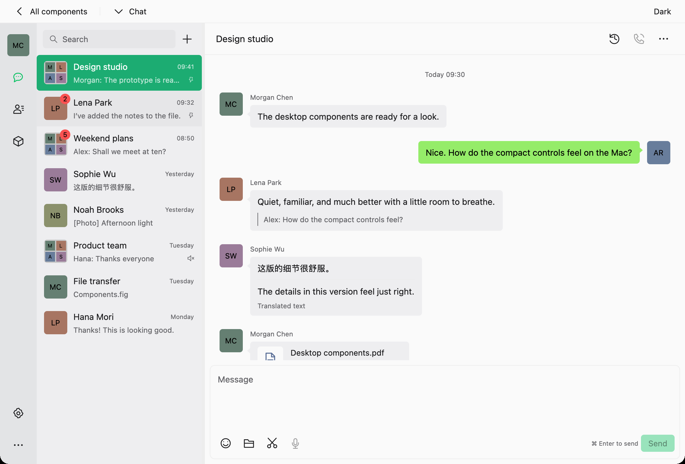
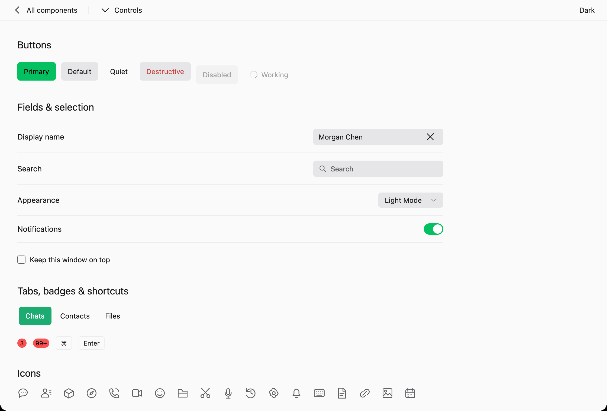

<div align="center">
  
  <h1>weGPUI</h1>
  <p><strong>WeUI-inspired components. Native Rust applications.</strong></p>
  <p>Build with controls, forms, navigation and desktop surfaces rendered by <a href="https://gpui.rs">GPUI</a>.</p>
  <p>
    <a href="https://codewhale-hq.github.io/weGPUI/"><strong>Explore the gallery</strong></a>
    &nbsp; · &nbsp; <a href="#quick-start">Quick start</a>
    &nbsp; · &nbsp; <a href="docs/INTEGRATION.md">Integration guide</a>
    &nbsp; · &nbsp; <a href="docs/STATUS.md">Project status</a>
  </p>
</div>

> [!NOTE]
> **Developer preview · 0.1.0 · unreleased.** Visual, interaction and accessibility qualification is in progress. No desktop platform has completed the full support criteria; mobile backends are experimental. See the [acceptance matrix](docs/ACCEPTANCE.md) and [remaining work](docs/COMPLETION.md).

<picture>
  <source media="(prefers-color-scheme: dark)" srcset="https://raw.githubusercontent.com/codewhale-hq/weGPUI/main/docs/receipts/macos-components-20261029/captures/macos-desktop-chat-default-dark-gpui.png">
  <source media="(prefers-color-scheme: light)" srcset="https://raw.githubusercontent.com/codewhale-hq/weGPUI/main/docs/receipts/macos-components-20261029/captures/macos-desktop-chat-default-light-gpui.png">
  
</picture>

*The native desktop gallery on macOS, with sample people and messages. See the [capture details](docs/receipts/macos-components-20261029/README.md).*

## A closer look

weGPUI brings [Tencent's WeUI 2.6.26](https://github.com/Tencent/weui) design language to [GPUI](https://gpui.rs), the GPU-accelerated framework behind Zed. weGPUI renders with native GPUI primitives, without an embedded browser.

<picture>
  <source media="(prefers-color-scheme: dark)" srcset="https://raw.githubusercontent.com/codewhale-hq/weGPUI/main/docs/receipts/macos-components-20261029/captures/macos-desktop-controls-default-dark-gpui.png">
  <source media="(prefers-color-scheme: light)" srcset="https://raw.githubusercontent.com/codewhale-hq/weGPUI/main/docs/receipts/macos-components-20261029/captures/macos-desktop-controls-default-light-gpui.png">
  
</picture>

*Desktop controls in the native macOS gallery: buttons, fields, choices and tabs.*

These recorded macOS captures show rendering, not complete platform or accessibility support. The [desktop receipt](docs/receipts/macos-components-20261029/README.md) identifies their source and limits.

- **Desktop surfaces:** chat layouts, conversation rows, messages, contacts, settings, history, menus, dialogs and emoji selection. [Desktop API →](docs/DESKTOP.md)
- **Controls and content:** buttons, cells, inputs, switches, sliders, navigation, pickers, overlays, image viewers and upload interfaces. [Component modules →](src/components/mod.rs)
- **Desktop and phone from one view tree:** a size class, safe-area root, rail-or-tab-bar shell and split-or-push panes. [Adaptive module →](src/adaptive.rs) · [Example →](examples/adaptive.rs)
- **Appearance:** light, dark and care themes, custom brand colours and host palettes.
- **Language and access:** 14 message catalogs, RTL layouts, keyboard navigation and modal focus handling. Translation, reader and platform qualification remain open. [Localisation →](docs/I18N.md) · [Acceptance →](docs/ACCEPTANCE.md)

The [browser gallery](https://codewhale-hq.github.io/weGPUI/) presents 71 native gallery routes with recorded previews and Rust source, plus a separately labelled interactive WeUI browser reference. The native previews are captures; GPUI does not run in the browser.

## Quick start

Install **Rust 1.95+** and the [GPUI build requirements](CONTRIBUTING.md#build-and-check). Linux also needs an X11 or Wayland desktop and GPUI's system libraries.

```sh
git clone https://github.com/codewhale-hq/weGPUI.git
cd weGPUI
cargo run --example gallery --locked
```

Try a small starting point or open the desktop chat example directly:

```sh
cargo run --example minimal --locked
cargo run --example gallery --locked -- --page desktop-chat --theme light
```

For more examples, including form state, localisation and theming, see the [integration guide](docs/INTEGRATION.md#more-examples).

## Use in an application

The preview currently needs **five matching local compatibility patches** configured at the consumer's workspace root. Cargo does not inherit those patches from a dependency.

Follow the [application integration guide](docs/INTEGRATION.md) for the exact dependencies, patches and initialization, or start with [the complete minimal example](examples/minimal.rs). A [reproducible source bundle](docs/PREVIEW-DISTRIBUTION.md) includes a separate consumer and the patched sources; it is not a published crate or signed installer.

## Platform status

Builds, sampled native behavior and complete platform support are separate milestones.

| Platform | Evidence so far | Still to qualify |
| --- | --- | --- |
| **macOS** | Build checks and sampled native input, accessibility and visual observations | Complete state, input and reader coverage; signed distribution |
| **Linux** | Source checks, X11 comparisons and sampled native interaction and Orca output; historical nested-Wayland checks | Complete reader, IME, hardware and distribution coverage |
| **Windows** | ARM64/MSVC build checks and standalone consumer; historical native interactions | Current visible UI, reader and distribution qualification |
| **iOS** | Experimental simulator launch and sampled touch navigation | Keyboard, IME, lifecycle, accessibility and device qualification |
| **Android** | Library type-checking | Backend selection and native runtime |

See [platform evidence](docs/PLATFORMS.md) and [release readiness](docs/RELEASE-READINESS.md) for the criteria and detailed receipts.

## Find your way around

| I want to… | Start here |
| --- | --- |
| Browse the components and their source | [Gallery](https://codewhale-hq.github.io/weGPUI/) · [Desktop components](docs/DESKTOP.md) · [Website guide](website/README.md) |
| Add weGPUI to an application | [Integration guide](docs/INTEGRATION.md) · [Minimal example](examples/minimal.rs) |
| Understand support and known limits | [Project status](docs/STATUS.md) · [Acceptance matrix](docs/ACCEPTANCE.md) |
| Review visual comparisons and provenance | [Visual evidence](docs/PARITY.md) · [Source attribution](docs/SOURCES.md) |
| Contribute or report a security issue | [Contributing](CONTRIBUTING.md) · [Security](SECURITY.md) · [Code of conduct](CODE_OF_CONDUCT.md) |
| Follow changes | [Changelog](CHANGELOG.md) |

[GitHub](https://github.com/codewhale-hq/weGPUI) is the canonical home for source, issues and pull requests. [CNB](https://cnb.cool/codewhale.net/weGPUI) is a read-only mirror.

## Licence

Original weGPUI code is **MIT OR Apache-2.0**. See [LICENSE-MIT](LICENSE-MIT) and [LICENSE-APACHE](LICENSE-APACHE).

WeUI design, example content and icons are Copyright Tencent, Inc., under the MIT licence. The distribution also identifies THL A29 Limited, a Tencent company. Their notices are preserved in [LICENSE-WEUI](LICENSE-WEUI) and [NOTICE](NOTICE).

The text input adapts GPUI's input example, Copyright Zed Industries, Apache-2.0; its attribution is preserved in the source and NOTICE. This is an independent project.
